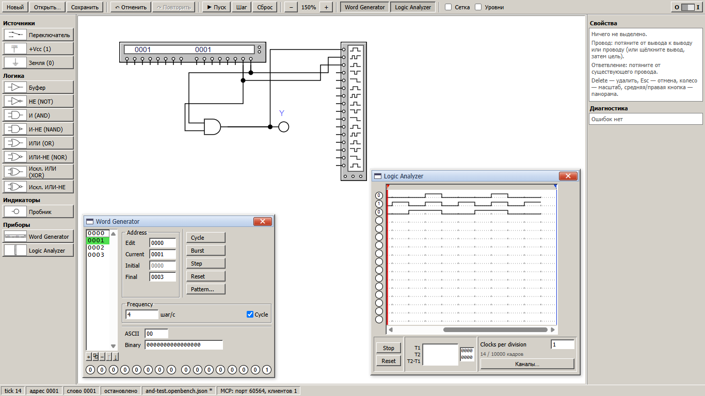
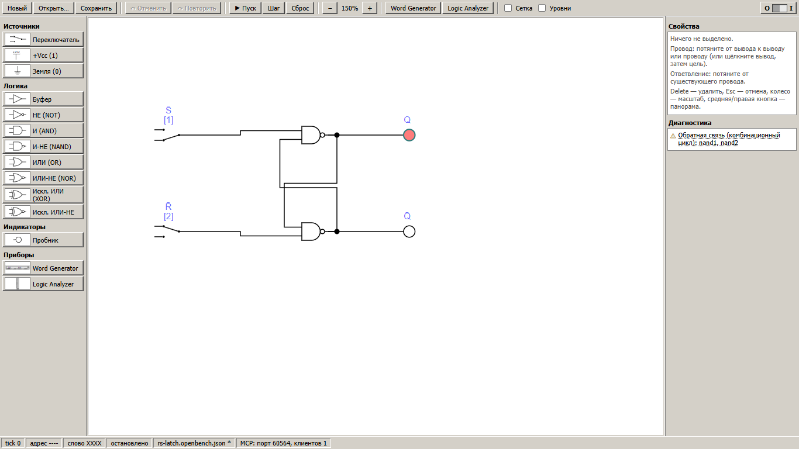

# OpenBench

Свободный настольный стенд для лабораторных работ по архитектуре ЭВМ и цифровой
схемотехнике. В нём есть редактор логических схем, генератор слов (Word Generator),
логический анализатор (Logic Analyzer) и локальный MCP-сервер, через который
AI-ассистент может собирать схемы и запускать симуляцию в открытом окне.





Скриншоты сняты с настоящего окна приложения (Tauri, Windows 11).

## Возможности

* **Редактор схем.** Палитра, размещение щелчком или перетаскиванием, привязка к сетке,
  выделение рамкой, перемещение, удаление, масштаб колесом, панорама. Провода
  протягиваются от вывода к выводу, ответвление — от середины провода (появляется точка
  соединения). Трассировка автоматическая и ортогональная: провода разных сетей не
  накладываются, пересечение проводов не соединяет их. Есть undo/redo и сообщения об
  ошибках подключения.
* **Элементы:** переключатель `INPUT` (клавиша `[1]`, `[2]`, …), пробник `OUTPUT`,
  `+Vcc` (1), земля (0), `BUFFER`, `NOT`, `AND`, `NAND`, `OR`, `NOR`, `XOR`, `XNOR`.
* **Word Generator.** 16-битные слова (до 1024), выходы `D0…D15` (`D0` — младший бит).
  Редактирование в hex и двоичном виде, вставка, дублирование, удаление и перестановка
  слов, шаблоны (счётчики, сдвиги). Кнопки Step / Burst / Cycle / Reset, частота шагов.
* **Logic Analyzer.** 16 каналов, временные диаграммы по общей оси tick, отдельное
  обозначение `X` и конфликта, курсоры T1/T2 со значениями, масштаб (clocks per
  division), прокрутка, скрытие и переименование каналов, очистка, ограниченный буфер с
  индикацией усечения. Неподключённый канал показывается как «—».
* **Симуляция.** Комбинационная логика с уровнями `0/1/X/E`. Результат не зависит от
  порядка элементов. Циклы диагностируются, защёлки (RS-триггер) сохраняют состояние.
  Шаги детерминированы.
* **Файлы** `*.openbench.json` с версией формата, проверкой при открытии и атомарной
  записью.
* **MCP:** 23 инструмента для сборки схем, симуляции и чтения сигналов. Изменения сразу
  видны в окне.

Программа работает без интернета, телеметрии и автообновлений.

## Установка и запуск

Требования:

* [Node.js](https://nodejs.org/) ≥ 20 (проверено на 24);
* для настольного приложения — [Rust](https://rustup.rs/) (stable) и системные
  зависимости Tauri 2:
  * **Windows 10/11:** Microsoft C++ Build Tools, WebView2 (в Windows 11 уже есть);
  * **Linux:** `libwebkit2gtk-4.1-dev`, `build-essential`, `libssl-dev`,
    `libayatana-appindicator3-dev`, `librsvg2-dev` (см. документацию Tauri).

```bash
git clone <repo> open-bench && cd open-bench
npm install

npm run tauri dev        # настольное приложение в режиме разработки
npm run tauri build      # установщики: apps/desktop/src-tauri/target/release/bundle/
```

Только интерфейс в браузере, без MCP-моста и системных диалогов:
`npm run dev`, затем откройте <http://127.0.0.1:1420>.

## Команды проверки

| Команда | Что делает |
|---|---|
| `npm run lint` | ESLint по всему репозиторию |
| `npm run typecheck` | `tsc` для core, desktop, mcp-server |
| `npm test` | Vitest: таблицы истинности, X, fan-out, конфликты, циклы, Word Generator, Logic Analyzer, сценарии AND/XOR/сохранение, трассировка, интеграция MCP ⇄ мост ⇄ движок, бенчмарк |
| `npm run test:e2e` | Playwright: сценарии редактора в браузере (сам поднимает dev-сервер) |
| `npm run test:rust` | `cargo test`: ограничение путей рабочей папки, атомарная запись, токен |
| `npm run build` | сборка UI (Vite) и MCP-сервера (esbuild) |
| `npm run test:tauri-sync` | сценарий синхронизации на **настоящем окне** (см. ниже) |
| `npm run examples` | пересоздать `examples/*.openbench.json` и `docs/project.schema.json` |

`test:tauri-sync`: запустите приложение с отладкой webview (Windows):

```powershell
$env:WEBVIEW2_ADDITIONAL_BROWSER_ARGUMENTS = "--remote-debugging-port=9333"
npm run tauri dev
# в другом терминале:
npm run build -w @openbench/mcp-server; npm run test:tauri-sync
```

## Первая схема: элемент И

1. В палитре **Приборы → Word Generator**, затем щелчок на листе. Затем **Логика → И
   (AND)** и **Приборы → Logic Analyzer**.
2. Протяните провода: `D0` генератора (правый нижний вывод) → вход `A`, `D1` → `B`, выход
   И → верхний вход анализатора `CH0`. Для наглядности добавьте `D0 → CH1` и `D1 → CH2`.
3. Двойной щелчок по генератору. В поле **Final** введите `0003`, затем для адресов 1–3
   задайте в поле **Binary** значения `…01`, `…10`, `…11`.
4. Четыре раза **Шаг** (F6), затем двойной щелчок по анализатору: `CH0 = 0,0,0,1`,
   `CH1 = 0,1,0,1`, `CH2 = 0,0,1,1`.

Подробно: [docs/examples/lab-1-and.md](docs/examples/lab-1-and.md). Готовые проекты
лежат в [examples/](examples).

### Клавиши

| | |
|---|---|
| Ctrl+N / Ctrl+O / Ctrl+S / Ctrl+Shift+S | новый / открыть / сохранить / сохранить как |
| Ctrl+Z / Ctrl+Y | отменить / повторить |
| Delete | удалить выделенное |
| Esc | отменить размещение или провод, снять выделение |
| Ctrl+A | выделить всё |
| F5 / F6 / F7 | пуск-пауза / шаг / сброс |
| 0–9, a–z | переключить INPUT с этой клавишей |
| колесо, средняя или правая кнопка, Alt+перетаскивание | масштаб, панорама |
| двойной щелчок | переключатель — переключить; прибор — открыть окно |

## MCP

```bash
npm run build -w @openbench/mcp-server
claude mcp add openbench -- node "/абсолютный/путь/open-bench/apps/mcp-server/dist/openbench-mcp.mjs"
```

Запустите OpenBench и попросите ассистента собрать и промоделировать схему. Инструменты,
ошибки, рабочая папка для файлов и безопасность описаны в
[docs/mcp-setup.md](docs/mcp-setup.md).

## Документация

* [Архитектура и IPC](docs/architecture.md)
* [Решения (ADR)](docs/decisions/)
* [Формат файла проекта](docs/project-format.md) и [JSON Schema](docs/project.schema.json)
* [Настройка MCP](docs/mcp-setup.md)

## Состояние проверок

* Windows 11 x64: сборка (`tauri build`, MSI и NSIS) и запуск проверены, включая
  сценарий синхронизации GUI ⇄ MCP на релизной сборке.
* Linux и macOS: код платформенно-нейтрален, но сборка на этих системах **ещё не
  проверялась**.

## Лицензия

[MIT](LICENSE). OpenBench — самостоятельный проект. Он не связан с коммерческими
схемотехническими пакетами и не совместим с их форматами файлов. Внешний вид
схем повторяет общепринятый стиль учебных методичек; все символы и окна нарисованы
заново.
